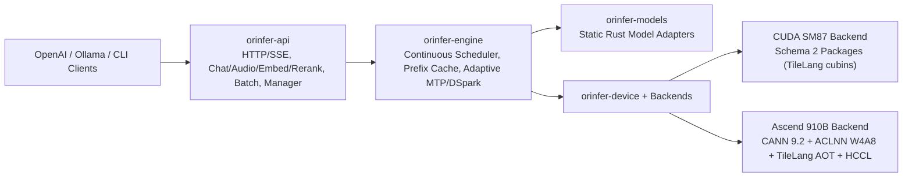

# Orinfer Documentation Hub

Welcome to the Orinfer documentation. All technical guides in `docs/` and module `README.md` files are maintained in English.

---

## Architecture at a Glance

---

## Guide Index

### 1. Deployment & Serving
- **[Serving Guide](serving.md)** — Single-model & managed multi-model serving, OpenAI & Ollama APIs, thinking, tools, JSON Schema, images, runtime knobs, CLI options, and environment variables.
- **[Offline JSONL Batch Inference](batch.md)** — High-throughput offline processing with `orinfer batch`, prefix-aware ordering, incremental writes, and `--resume`.
- **[DSv4.1 Ascend 910B Production Guide](deepseek-v41-production.md)** — Installing, upgrading, configuring, monitoring, and rolling back DSv4.1 TP8 on Ascend 910B / CANN 9.2.
- **[DeepSeek Harness Integration](deepseek-harness.md)** — Connecting `@deepseek-ai/dsh` to Orinfer.
- **[Client Configuration Examples](../examples/README.md)** — Ready-to-use configs for OpenCode, Pi, DeepSeek Harness, and `run-model`.

### 2. Specialized Models & Modalities
- **[Speech Recognition (Qwen3-ASR-1.7B)](audio.md)** — Audio transcription via CLI, `/v1/audio/transcriptions`, and Chat `input_audio`.
- **[Multimodal Embeddings (Nemotron-3.5-Embed-1B)](embeddings.md)** — Text, image, and multi-image retrieval via `/v1/embeddings` and `embed-model`.
- **[Query-Document Reranking (Qwen3-Reranker-0.6B)](reranking.md)** — Causal yes/no relevance scoring via `/v1/rerank` and `rerank-model`.

### 3. Packages, Quantization & Offline Build
- **[Model Execution Packages & Device Backends](model-packages.md)** — CUDA Schema 2 & Ascend Schema 1 package contracts, installation, validation, compaction, and backend boundaries.
- **[Ascend 910B (DSv4.1) Offline Build Pipeline](ascend-a2-build.md)** — Building, prepacking, tuning, DSpark/vision packaging, and compact RoPE/shared-JSON release for A2.
- **[E8P Quantization Technical Note](quantization.md)** — E8P Q2 lattice codebook, U16 bit layout, INT4 bit-plane decomposition, Q2_K comparison, and two-stage `[4,1]` Q4 extension.
- **[Offline Model Builders](../tools/model/README.md)** — [Qwen3.5 Dense](../tools/model/qwen35/README.md) · [Flash Next](../tools/model/flash_next/README.md) · [Quantization Tools](../tools/quantization/README.md) · [Vision Tools](../tools/vision/README.md).
- **[GPU / NPU TileLang Kernels](../kernels/README.md)** — Production CUDA/Ascend kernels and shared compute cores.

### 4. Performance, Quality & Development
- **[Performance Reference](performance.md)** — Latest Orin SM87 (Schema 2 + P1–P6) and Ascend 910B3 TP8 baselines, vLLM comparisons, and methodology.
- **[Development Guide](development.md)** — Workspace layout, external worktrees, 7-day dependency maturity audit, and test commands.
- **[Build, Checks & Release](../tools/build/README.md)** — Python/uv environments, host CUDA 12.6 / CANN 9.2 toolchains, CI checks, and release packaging.
- **[Benchmarking Toolkit](../tools/bench/README.md)** · **[API Validation](../tools/api/README.md)** · **[Quality Evaluation](../tools/eval/README.md)**.
